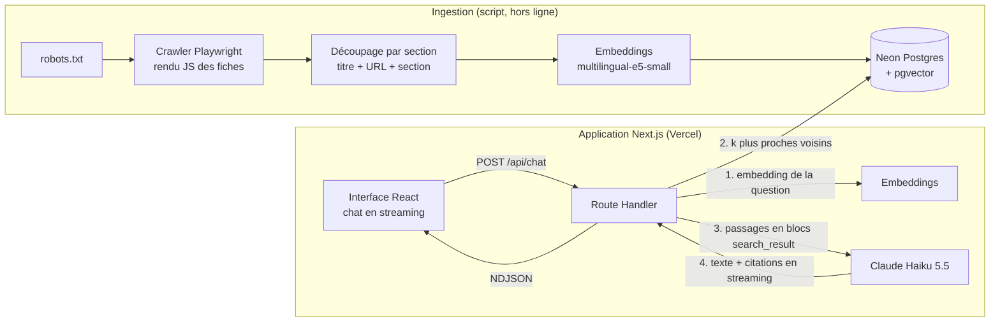

# Lux-Guide Assistant

[](https://github.com/zegueri/lux-guide-assistant/actions/workflows/ci.yml)

**Démo : https://lux-guide-assistant.vercel.app**

[Français](#français) · [English](#english)

---

## Français

Assistant qui répond en français aux questions sur l'installation et le travail au
Luxembourg (logement, frontaliers, impôts, transports, démarches), **uniquement à partir du
guide [lux-guide.github.io](https://lux-guide.github.io)**. Chaque réponse cite ses sources :
une pastille numérotée ouvre la bonne fiche **et surligne le passage cité**. Quand le guide
ne couvre pas la question, l'assistant le dit.

Projet réalisé à partir du [sujet n°3 de l'exercice de recrutement IA de Foyer](https://lux-guide.github.io/recrutement-ia/)
(« un chatbot pour les nouveaux arrivants »).

### Le problème

Le guide compte 36 fiches et 55 questions-réponses. Un nouvel arrivant a une question
précise (« combien de jours de télétravail pour un frontalier ? ») et ne sait pas dans
quelle fiche chercher. Un chatbot qui répond « de mémoire » invente des montants et des
délais ; il faut donc un système qui **cherche d'abord dans le guide**, répond à partir des
passages trouvés, montre d'où vient chaque affirmation, et sait dire « je ne sais pas ».

### Architecture



1. **Ingestion** (`npm run ingest`) : le site construit ses pages en JavaScript, donc un
   crawler poli (respect de `robots.txt`, pause entre les pages) les affiche dans Chromium
   sans interface, les découpe par section et stocke les vecteurs dans Postgres + pgvector.
2. **Question** (`POST /api/chat`) : la question est vectorisée, Postgres renvoie les
   6 passages les plus proches, Claude rédige la réponse à partir d'eux seuls et l'API
   renvoie texte et citations en streaming.

Détail de chaque choix : [docs/ARCHITECTURE.md](docs/ARCHITECTURE.md).

### Stack

Next.js 16 (App Router, Route Handlers) · React 19 · TypeScript strict · Tailwind 4 ·
API Claude (`@anthropic-ai/sdk`, Claude Haiku 5.5) · Postgres + pgvector (Neon ; PGlite
en local et dans les tests) · transformers.js · Playwright · Vitest · GitHub Actions · Vercel.

### Choix et compromis

| Choix | Pourquoi | Compromis |
|---|---|---|
| **Citations natives** (blocs `search_result` de l'API Claude) | Claude renvoie des citations structurées (passage exact, source) au lieu de « [1] » écrits à la main, qui peuvent être inventés | Format propre à l'API Claude |
| **Surlignage par « text fragments »** (`#:~:text=début,fin`) | Le lien ouvre la fiche et surligne le passage, sans toucher au site | Chrome, Edge et Safari surlignent ; Firefox ouvre seulement la fiche |
| **Découpage par section**, 1 200 caractères max, 1 paragraphe de recouvrement | Suit la structure voulue par l'auteur ; le titre de la fiche est ajouté au texte vectorisé | Morceaux de tailles inégales. 600, 1 200 et 2 000 caractères donnent des scores équivalents sur ce corpus (sections déjà courtes) |
| **Embeddings locaux** (`multilingual-e5-small`, transformers.js) plutôt que Voyage AI (recommandé par Anthropic) | Pas de deuxième clé API, gratuit, les textes ne quittent pas le serveur | Démarrage à froid d'environ 7 s sur Vercel (téléchargement du modèle), similarités tassées qui rendent le seuil délicat. Voyage reste disponible : `EMBEDDING_PROVIDER=voyage` |
| **pgvector** plutôt qu'une base vectorielle dédiée | Une seule base pour le texte, les métadonnées et les vecteurs, en SQL standard ; offre gratuite Neon | Index HNSW inutile à 196 lignes, présent pour montrer le passage à l'échelle |
| **PGlite** (Postgres en WebAssembly) en local et dans les tests | Le même SQL qu'en production, sans Docker ni compte cloud | Un seul processus à la fois sur le dossier local |
| **Seuil « je ne sais pas »** avant l'appel au LLM | Une question hors sujet obtient une réponse honnête sans appel payant | Seuil calibré sur le jeu d'évaluation, marge faible avec e5 |
| **Claude Haiku 5.5**, effort `medium` | Le plus petit modèle suffit pour rédiger à partir d'extraits | En effort `low`, Haiku dupliquait des phrases (résumé puis citation) : `medium` corrige pour un coût qui reste très bas |

### Coût et latence (mesurés en production)

- **Coût par question** : environ **0,001 $** (environ 3 500 tokens en entrée, 1 000 en
  sortie, réflexion comprise), soit environ 5 000 questions pour 5 $. Une question hors
  sujet ne coûte rien (pas d'appel au LLM).
- **Recherche** : 8 ms par question en local, 22 ms avec Neon.
- **Réponse complète** : quelques secondes en streaming ; le premier appel après une période
  d'inactivité ajoute environ 7 s (téléchargement du modèle d'embeddings).
- **Protection de la démo** : 10 questions par minute et par adresse IP, questions limitées
  à 1 000 caractères, plafond de dépense dans la console Anthropic.

### Évaluation

`npm run eval` mesure la recherche seule (gratuit, reproductible) sur 20 questions avec la
fiche attendue et 6 questions hors sujet. Méthode et détail :
[eval/README.md](eval/README.md) et [eval/results.md](eval/results.md).

| Métrique | Résultat |
|---|---|
| hit@1 (bonne fiche en premier) | 95 % (19/20) |
| hit@3 / hit@5 | 100 % / 100 % |
| MRR | 0,975 |
| Questions hors sujet rejetées sans appel au LLM | 100 % (6/6) |

Limites assumées : jeu petit et écrit par l'auteur (scores optimistes), seuil calibré sur
ce même jeu, rédaction des réponses non évaluée automatiquement (piste : un « LLM juge »).

### Qualité

- **78 tests Vitest** : découpage, robots.txt, extraction HTML, recherche pgvector (PGlite
  en mémoire), traduction du flux Claude, citations et surlignage, prompt, protocole NDJSON,
  état de l'interface, limitation de débit.
- **4 tests Playwright** : poser une question et voir la réponse, ses citations et ses
  sources ; question hors sujet ; erreur serveur (API simulée, sans clé ni coût).
- **GitHub Actions** : lint, typecheck, tests, build et Playwright à chaque push.

### Lancer le projet

Prérequis : Node.js 20.19 ou plus récent, et une clé API Claude
([platform.claude.com](https://platform.claude.com)).

```bash
git clone https://github.com/zegueri/lux-guide-assistant.git
cd lux-guide-assistant
npm install
npx playwright install chromium     # navigateur du crawler et des tests e2e
cp .env.example .env.local          # puis renseigner ANTHROPIC_API_KEY
npm run ingest                      # crawl du site + index (PGlite local si DATABASE_URL est vide)
npm run dev                         # http://localhost:3000
```

Autres commandes : `npm test`, `npm run test:e2e`, `npm run eval`,
`npm run search -- "votre question"`, `npm run lint`, `npm run typecheck`.

Déploiement : Vercel (variables `ANTHROPIC_API_KEY` et `DATABASE_URL` vers Neon), après
`npm run ingest -- --cache` avec `DATABASE_URL` pointant sur Neon.

### Limites et pistes

- L'assistant ne voit pas la fiche ouverte dans un autre onglet ; il accepte
  `?fiche=frontalier` pour favoriser une fiche. Un widget intégré au site irait plus loin.
- Limitation de débit en mémoire, « au mieux » en serverless (Redis/Upstash pour un vrai
  service).
- Pistes : recherche hybride (BM25 + vecteurs), reranking, évaluation de la rédaction par
  un LLM juge, questions réelles d'utilisateurs pour un jeu d'évaluation honnête.

---

## English

A French-language assistant that answers questions about moving to and working in
Luxembourg (housing, cross-border workers, taxes, transport, paperwork), **using only the
[lux-guide.github.io](https://lux-guide.github.io) guide**. Every answer cites its sources:
a numbered badge opens the right page **and highlights the cited passage**. When the guide
does not cover a question, the assistant says so.

Built from [topic #3 of Foyer's AI hiring exercise](https://lux-guide.github.io/recrutement-ia/)
("a chatbot for newcomers").

### The problem

The guide has 36 topic pages and 55 FAQ entries. A newcomer has a precise question ("how many
remote-work days for a cross-border worker?") and does not know which page to read. A chatbot
answering "from memory" invents amounts and deadlines, so the system must **search the guide
first**, answer from the retrieved passages only, show where each statement comes from, and be
able to say "I don't know".

### Architecture

See the diagram above. Two separate stages:

1. **Ingestion** (`npm run ingest`): the site renders its pages in JavaScript, so a polite
   crawler (honours `robots.txt`, pauses between pages) renders them in headless Chromium,
   splits them by section and stores the vectors in Postgres + pgvector.
2. **Question** (`POST /api/chat`): the question is embedded, Postgres returns the 6 nearest
   passages, Claude writes the answer from those passages only, and the API streams text and
   citations back as NDJSON.

Every decision is explained (in French) in [docs/ARCHITECTURE.md](docs/ARCHITECTURE.md).

### Stack

Next.js 16 (App Router, Route Handlers) · React 19 · strict TypeScript · Tailwind 4 ·
Claude API (`@anthropic-ai/sdk`, Claude Haiku 5.5) · Postgres + pgvector (Neon; PGlite
locally and in tests) · transformers.js · Playwright · Vitest · GitHub Actions · Vercel.

### Choices and trade-offs

| Choice | Why | Trade-off |
|---|---|---|
| **Native citations** (Claude API `search_result` blocks) | Claude returns structured citations (exact passage, source) instead of hand-written "[1]" markers that can be made up | Specific to the Claude API |
| **Highlighting with text fragments** (`#:~:text=start,end`) | The link opens the page and highlights the passage, without changing the site | Chrome, Edge and Safari highlight; Firefox only opens the page |
| **Section-based chunking**, 1,200 characters max, 1-paragraph overlap | Follows the author's structure; the page title is prepended to the embedded text | Uneven chunk sizes. 600, 1,200 and 2,000 characters score the same on this corpus (sections are already short) |
| **Local embeddings** (`multilingual-e5-small`, transformers.js) instead of Voyage AI (Anthropic's recommendation) | No second API key, free, text never leaves the server | ~7 s cold start on Vercel (model download), compressed similarity scores make the threshold delicate. Voyage is still available: `EMBEDDING_PROVIDER=voyage` |
| **pgvector** instead of a dedicated vector database | One database for text, metadata and vectors, in plain SQL; free Neon tier | HNSW index is unnecessary at 196 rows, kept to show how it scales |
| **PGlite** (Postgres in WebAssembly) locally and in tests | Same SQL as production, no Docker or cloud account | Only one process at a time on the local folder |
| **"I don't know" threshold** before calling the LLM | Off-topic questions get an honest answer without a paid call | Threshold tuned on the evaluation set, small margin with e5 |
| **Claude Haiku 5.5**, effort `medium` | The smallest model is enough to write from provided passages | At effort `low`, Haiku duplicated sentences (summary then quote); `medium` fixes it at a still very low cost |

### Cost and latency (measured in production)

- **Cost per question**: about **$0.001** (~3,500 input tokens, ~1,000 output tokens including
  thinking), i.e. about 5,000 questions for $5. Off-topic questions cost nothing (no LLM call).
- **Retrieval**: 8 ms per question locally, 22 ms with Neon.
- **Full answer**: a few seconds, streamed; the first call after idle time adds ~7 s
  (embedding model download).
- **Demo protection**: 10 questions per minute per IP, 1,000-character questions, spend limit
  in the Anthropic console.

### Evaluation

`npm run eval` measures retrieval only (free, reproducible) on 20 questions with their
expected page plus 6 off-topic questions. Method and details:
[eval/README.md](eval/README.md) and [eval/results.md](eval/results.md) (in French).

| Metric | Result |
|---|---|
| hit@1 (right page first) | 95% (19/20) |
| hit@3 / hit@5 | 100% / 100% |
| MRR | 0.975 |
| Off-topic questions rejected without an LLM call | 100% (6/6) |

Known limits: a small set written by the author (optimistic scores), a threshold tuned on the
same set, and answer quality not evaluated automatically (next step: an LLM judge).

### Quality

- **78 Vitest tests**: chunking, robots.txt, HTML extraction, pgvector search (in-memory
  PGlite), Claude stream translation, citations and highlighting, prompt, NDJSON protocol,
  UI state, rate limiting.
- **4 Playwright tests**: ask a question and see the answer, citations and sources;
  off-topic question; server error (mocked API, no key or cost).
- **GitHub Actions**: lint, typecheck, tests, build and Playwright on every push.

### Run it

Requirements: Node.js 20.19 or later, and a Claude API key
([platform.claude.com](https://platform.claude.com)).

```bash
git clone https://github.com/zegueri/lux-guide-assistant.git
cd lux-guide-assistant
npm install
npx playwright install chromium     # browser for the crawler and e2e tests
cp .env.example .env.local          # then set ANTHROPIC_API_KEY
npm run ingest                      # crawl + index (local PGlite when DATABASE_URL is empty)
npm run dev                         # http://localhost:3000
```

Other commands: `npm test`, `npm run test:e2e`, `npm run eval`,
`npm run search -- "your question"`, `npm run lint`, `npm run typecheck`.

Deployment: Vercel (`ANTHROPIC_API_KEY` and `DATABASE_URL` pointing to Neon), after running
`npm run ingest -- --cache` with `DATABASE_URL` set to Neon.

### Limits and next steps

- The assistant cannot see the page open in another tab; it accepts `?fiche=frontalier` to
  favour a page. A widget embedded in the site would go further.
- In-memory rate limiting is best-effort on serverless (Redis/Upstash for a real service).
- Next steps: hybrid search (BM25 + vectors), reranking, LLM-judge evaluation of answers,
  real user questions for an honest evaluation set.
