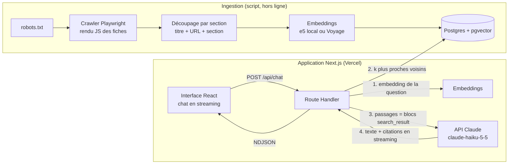

# Architecture et choix techniques

Ce document explique **ce que fait** Lux-Guide Assistant, **comment** il le fait, et
**pourquoi** chaque choix a été fait. Chaque décision est résumée en quelques phrases
défendables en entretien, avec son compromis.

## 1. Le problème

Le site [lux-guide.github.io](https://lux-guide.github.io) rassemble des fiches pratiques
pour s'installer et travailler au Luxembourg (logement, frontaliers, impôts, transports,
démarches). Un nouvel arrivant a des questions précises (« combien de jours de télétravail
pour un frontalier français ? ») et ne sait pas dans quelle fiche chercher.

L'assistant répond **en français**, **uniquement à partir du site**, **cite ses sources**
(liens cliquables qui ouvrent la bonne fiche et surlignent le passage) et **dit qu'il ne
sait pas** quand l'information n'est pas dans le guide.

Le sujet de recrutement (Foyer, sujet n°3) cite trois idées : reconnaître la page lue,
ouvrir la bonne fiche, surligner le passage. Les deux dernières sont couvertes ; la
première l'est en partie (voir § 6).

## 2. Vue d'ensemble



Deux temps bien séparés :

1. **Ingestion** (`npm run ingest`) : lancée à la main quand le site change. Elle parcourt
   le site, découpe les fiches, calcule les embeddings et remplit la base.
2. **Question** (`POST /api/chat`) : à chaque question, on calcule l'embedding de la
   question, on récupère les k passages les plus proches, on les donne à Claude, et on
   renvoie la réponse en streaming avec ses citations.

## 3. Arborescence

```
src/
  app/
    page.tsx              page d'accueil (chat)
    api/chat/route.ts     Route Handler : RAG + streaming
  components/             composants React de l'interface
  lib/
    config.ts             lecture et validation des variables d'environnement (zod)
    crawler/              robots.txt, extraction du contenu rendu
    rag/                  découpage, recherche, prompt, citations, surlignage
    embeddings/           fournisseurs d'embeddings (local / Voyage)
    db/                   connexion Postgres (pg) ou PGlite, schéma
    chat/                 protocole de streaming partagé client/serveur
scripts/
  ingest.ts               crawl -> découpage -> embeddings -> base
  eval.ts                 mesure hit@k / MRR sur le jeu d'évaluation
eval/questions.json       jeu d'évaluation (question -> page attendue)
tests/                    tests Vitest (unitaires)
e2e/                      test Playwright (parcours utilisateur)
```

## 4. Choix techniques et compromis

### 4.1 Next.js App Router + Route Handlers (pas tRPC)

L'interface et l'API vivent dans le même projet, déployé en une fois sur Vercel. Un Route
Handler (`app/api/chat/route.ts`) reçoit la question et renvoie un `ReadableStream` : c'est
l'API Web standard (`Request`/`Response`), sans couche supplémentaire. tRPC apporterait du
typage de bout en bout, mais pour **une seule route** en streaming il ajouterait plus de
complexité que de valeur ; le typage est partagé via un fichier `lib/chat/protocol.ts`.

### 4.2 Crawler : rendu JavaScript avec Playwright

Le site lux-guide est une application à page unique : le HTML ne contient pas le texte des
fiches, il est construit en JavaScript (`app/kb.js`) et affiché selon l'ancre de l'URL
(`#fiche/frontalier`). Un simple `fetch` du HTML ne verrait donc rien. Le crawler ouvre le
site dans Chromium sans interface (Playwright, déjà utilisé pour les tests e2e), lit la
liste des fiches dans la page, puis affiche chaque fiche en changeant l'ancre.

Politesse : `robots.txt` est lu et respecté (le site n'en a pas aujourd'hui : un 404 veut
dire « tout est autorisé », RFC 9309), un User-Agent identifie le robot, **une seule page
est chargée** (la navigation par ancre ne refait pas de requête réseau) et une pause sépare
chaque fiche. Compromis : Chromium est lourd, mais il n'est utilisé qu'au moment de
l'ingestion, jamais en production.

### 4.3 Découpage par section (« structure-aware chunking »)

Une fiche est découpée selon ses sous-titres (`h2`) : un morceau = une section, avec le
titre de la fiche, le nom de la section, l'URL et la catégorie. Une section trop longue est
coupée par paragraphes (maximum ~1 200 caractères, un paragraphe de recouvrement). Le
« chapô », l'encadré « À retenir » et chaque question de la FAQ forment leurs propres
morceaux.

Pourquoi : un découpage à taille fixe coupe au milieu d'une idée. Le découpage par section
suit la structure voulue par l'auteur, et le titre ajouté en tête du texte embarqué
(« Habiter en France… — Le télétravail a deux plafonds ») aide la recherche. Compromis :
les morceaux ont des tailles inégales ; trop gros, ils diluent le sens, trop petits ils
perdent le contexte. La taille est réglable et l'évaluation (§ 5) sert à trancher.

### 4.4 Embeddings : local par défaut, Voyage AI en option

Anthropic ne propose pas de modèle d'embeddings ; sa documentation renvoie vers **Voyage
AI** (aujourd'hui servi par MongoDB Atlas), avec `voyage-4` comme modèle équilibré et
multilingue. Le projet supporte deux fournisseurs, choisis par `EMBEDDING_PROVIDER` :

| | **Local** (`local`, par défaut) | **Voyage AI** (`voyage`) |
|---|---|---|
| Modèle | `Xenova/multilingual-e5-small` (transformers.js, ONNX quantifié) | `voyage-4` |
| Dimension | 384 | 1024 |
| Clé API | aucune | `VOYAGE_API_KEY` (2ᵉ fournisseur) |
| Coût | 0 € | payant au token (offre gratuite à l'inscription) |
| Qualité | correcte en français, petit modèle | meilleure, modèle récent |
| Confidentialité | les textes ne quittent pas le serveur | les questions partent chez Voyage |
| Déploiement Vercel | runtime ONNX (~45 Mo) + modèle (~120 Mo) téléchargé au démarrage à froid | un simple appel HTTP |
| Latence | démarrage à froid de plusieurs secondes, puis ~10-50 ms | ~100-300 ms réseau à chaque question |

Point important : **la question et les documents doivent être vectorisés par le même
modèle**. Changer de fournisseur impose de relancer l'ingestion ; le nom du modèle est
stocké dans la base et vérifié à chaque requête pour éviter un mélange silencieux.

Choix : **local par défaut**, pour qu'un recruteur puisse cloner et lancer le projet avec
une seule clé (Anthropic), et parce que le corpus est petit (≈ 40 fiches). Si les
démarrages à froid sur Vercel sont gênants, on passe à Voyage en changeant une variable
et en relançant l'ingestion.

### 4.5 Postgres + pgvector (Neon), et PGlite en local

pgvector ajoute à Postgres un type `vector` et des opérateurs de distance (`<=>` pour la
distance cosinus). Avantage : une seule base pour le texte, les métadonnées et les
vecteurs, interrogée en SQL standard, sans service vectoriel de plus. Neon offre un
Postgres serverless gratuit avec pgvector.

En local et dans les tests, le projet utilise **PGlite** : le vrai Postgres compilé en
WebAssembly, qui tourne dans le processus Node, avec l'extension pgvector. On teste donc le
même SQL qu'en production, sans Docker ni compte cloud. Les deux clients (`pg` et PGlite)
exposent la même méthode `query(sql, params)`, ce qui permet une petite interface commune.

Index : un index HNSW (`vector_cosine_ops`) est créé. Avec quelques centaines de lignes,
une recherche exacte serait aussi rapide ; l'index montre comment le système passerait à
l'échelle (recherche approchée, rappel légèrement inférieur à 100 %).

### 4.6 Claude : citations natives avec les blocs `search_result`

Les passages récupérés sont envoyés à Claude sous forme de blocs `search_result` (source =
URL de la fiche, titre = fiche + section, un bloc de texte par paragraphe), avec les
citations activées. Claude renvoie alors des citations **structurées** (`cited_text`,
`source`, index du passage) : on n'a pas à faire confiance à des « [1] » écrits par le
modèle, qui pourraient être inventés. Le prompt système impose de répondre uniquement à
partir de ces passages, en français, et de dire « je ne sais pas » sinon.

Réglages, d'après la documentation à jour (skill claude-api) :

- modèle `claude-haiku-5-5`, **streaming** (`client.beta.messages.stream`). Haiku plutôt
  qu'Opus : pour rédiger une réponse à partir d'extraits fournis, le plus petit modèle
  suffit, pour environ 0,09 centime par question (mesuré), au lieu de 1 à 2 centimes estimés
  avec Opus. Le modèle tient dans une constante (`MODEL`) :
  passer à Sonnet ou Opus est un changement d'une ligne ;
- **niveau d'effort `medium`** (le défaut de Haiku 5.5) : la réflexion adaptative est
  active, et l'effort règle sa profondeur. Mesuré sur la démo : en `low`, Haiku résumait
  une idée puis recopiait mot pour mot le passage cité (doublons) ; en `medium`, la réponse
  est propre et citée, pour ~0,0009 $ par question (~3 500 tokens en entrée, ~1 000 en
  sortie réflexion comprise), soit environ 5 500 questions pour 5 $ ;
- **refus** : si `stop_reason === "refusal"`, la réponse partielle est jetée et
  l'interface affiche un message clair. Haiku 5.5 n'a pas de repli automatique côté
  serveur (paramètre `fallbacks`), donc rien n'est relancé ;
- **pas de cache de prompt** : le prompt système (~500 tokens) est sous la taille minimale
  qu'un préfixe doit atteindre pour être mis en cache, et les extraits changent à chaque
  question ; un `cache_control` n'apporterait rien (à revoir si le prompt grossit) ;
- `max_tokens` plafonné à 4 096 (réflexion comprise : démo publique, coût maîtrisé) ;
- l'historique est renvoyé en texte simple (3 derniers échanges), sans les extraits des
  tours précédents, pour limiter les tokens ; une question de relance (« et pour la
  Belgique ? ») est complétée par la question précédente avant la recherche.

### 4.7 « Je ne sais pas » à deux niveaux

1. **Avant l'appel au LLM** : si le passage le plus proche a une similarité sous un seuil
   (calibré avec les questions hors sujet du jeu d'évaluation), on répond directement que
   le guide ne couvre pas la question. Aucun appel payant.
2. **Dans le prompt** : Claude a pour consigne de dire qu'il ne sait pas si les passages ne
   contiennent pas la réponse, même quand ils parlent du même sujet.

### 4.8 Surlignage du passage : les « text fragments »

Chaque citation devient un lien du type
`https://lux-guide.github.io/#fiche/frontalier:~:text=Le%20premier%20plafond,…` : le
navigateur ouvre la fiche **et surligne le passage cité** (standard des navigateurs
Chromium et Safari ; Firefox ouvre la fiche sans surligner). Testé sur le site : le
surlignage fonctionne malgré le rendu en JavaScript.

### 4.9 Protocole de streaming : NDJSON

Le Route Handler renvoie une ligne JSON par événement : d'abord les sources récupérées,
puis les morceaux de texte, les citations, et un événement de fin (ou d'erreur, ou de
refus). Le client lit le flux avec `response.body.getReader()`. C'est plus simple à
expliquer et à tester que du Server-Sent Events, et les types sont partagés entre client
et serveur.

### 4.10 Tests et qualité

- **Vitest** : découpage, robots.txt, text fragments, recherche vectorielle (sur PGlite
  avec de faux embeddings déterministes), construction du prompt, lecture du flux NDJSON.
- **Playwright** : un parcours complet (poser une question, voir la réponse et ses
  sources). L'API est simulée (`page.route`) : le test vérifie l'interface sans clé ni
  coût, et tourne en CI.
- **GitHub Actions** : lint, typecheck, tests unitaires, build, test e2e.
- **Évaluation de la recherche** : 15 à 20 questions avec la page attendue ; le script
  mesure hit@1, hit@3, hit@5 et le MRR. C'est la recherche qui est évaluée (pas la
  rédaction) : sans le bon passage, le LLM ne peut pas bien répondre.

## 5. Évaluation

Voir `eval/` et la section Résultats du README (rempli par `npm run eval`).

## 6. Limites connues et pistes

- **Page lue par l'utilisateur** : l'assistant est une application séparée du site ; il ne
  peut pas savoir quelle fiche est ouverte dans un autre onglet. Il accepte un paramètre
  `?fiche=frontalier` qui donne la priorité aux passages de cette fiche ; un vrai widget
  intégré au site (hors de notre contrôle) permettrait d'aller plus loin.
- **Limitation de débit** en mémoire : best effort sur du serverless (chaque instance a sa
  mémoire). Pour un vrai service : Upstash Redis ou équivalent.
- Recherche hybride (BM25 + vecteurs) et reranking (Voyage `rerank-3`) : pistes pour
  améliorer encore la recherche si l'évaluation le justifie.
